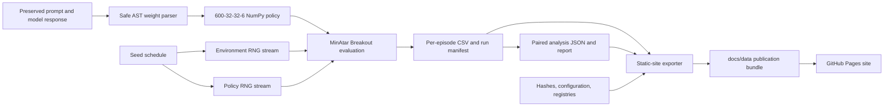

# Development and reproducibility guide

This guide describes the checked-in implementation and the current corrected evaluation. It does not replace the dated forensic reports or claim that every command has been rerun during documentation work. The published summary and research limitations are in the [root README](../README.md); detailed numerical methods are in the [Phase 2 report](../PHASE_2_CORRECTED_EVALUATION_REPORT.md).

## Repository map

| Concern | Code or data |
|---|---|
| MinAtar wrapper and 6-channel observation | `environment/breakout.py`, `environment/observations.py` |
| Action mapping | `environment/actions.py` |
| 600-32-32-6 network and inference | `network/architecture.py`, `network/inference.py` |
| Safe assignment parser and NPZ I/O | `network/weight_parser.py`, `network/weight_loader.py` |
| Historical evaluator | `evaluation/evaluate.py`, `scripts/run_evaluation.py` |
| Corrected evaluator and stream derivation | `evaluation/corrected_evaluate.py`, `evaluation/rng_streams.py`, `scripts/run_corrected_evaluation.py` |
| Corrected analysis | `evaluation/corrected_analysis.py`, `scripts/analyze_corrected_evaluation.py` |
| Primary corrected source records | `experiments/corrected_evaluation/` |
| Separate Argon High iterative records | `experiments/argon_high_iterative_development/` |
| Static website | `docs/index.html`, `docs/assets/`, `docs/data/` |
| Website exporter | `scripts/export_research_site_data.py` |

## Execution and data flow



The corrected run builds one seed schedule from seed groups 42, 100, and 200. Each base seed is expanded through `numpy.random.SeedSequence(base_seed).spawn(2)`. One child derives the environment seed and one derives the policy seed. The MinAtar wrapper owns environment randomness (including sticky-action draws); the policy's categorical sampler owns a distinct `RandomState`. The same base and derived identifiers are supplied to each condition for pairing. This separates PRNG state consumption and makes runs replayable; it does not make the streams mathematically independent.

For each step, the native MinAtar observation is mapped to the project's six channels, flattened in row-major order with channel as the innermost dimension, and passed through two `tanh` hidden layers. The output is six linear logits; stable softmax probabilities are sampled categorically. The evaluator records scores, lengths, selected and executed action counts, cutoff/terminal status, seed identifiers, and trajectory hashes in the raw CSVs and run manifest.

## Install and run tests

Requires Python 3.12 or later and [uv](https://docs.astral.sh/uv/). The project dependencies are declared in `pyproject.toml`.

```bash
uv venv .venv --python 3.12
source .venv/bin/activate
uv pip install -e .
pytest -q
```

The complete suite includes interactive Tk visualizer tests. The recorded macOS environment uses Tk 9.0, where those GUI tests fail during Tk startup (`tk scaling` produces NaN and Cocoa service connections fail); those failures are not successful GUI checks. The Pages workflow runs the non-GUI data and browser-conformance checks, then Node browser-module tests:

```bash
python scripts/export_research_site_data.py --check
pytest -q tests/test_site_export.py tests/test_browser_conformance.py
node --test tests/site_conformance.test.mjs
```

The browser/Python tests compare selected observations, transitions, and network outputs against fixtures and the Python implementation. They do not establish parity for every state or make the browser Arena's random streams equivalent to NumPy's.

## Reconstruct a candidate from a preserved response

The safe parser accepts a response string, extracts the final weight-edit block, initializes the six tensors to zero, and applies only its permitted numerical assignments. It does not call a model provider.

```python
from pathlib import Path
from network.weight_parser import SafeASTWeightParser
from network.weight_loader import save_weights_npz

response = Path("gemini/response_raw.txt").read_text()
weights, report = SafeASTWeightParser(strict=True).parse_text(response)
if report.errors:
    raise RuntimeError(report.errors)
save_weights_npz("/tmp/reconstructed-candidate.npz", weights)
```

Use an output path outside the repository when inspecting preserved responses. `gemini/parse_weights.py` is a convenience script that rewrites the tracked `gemini/generated_weights.npz` and updates `gemini/metadata.json`; it is not a read-only inspection command. The three Argon High iterative reconstructions have their own sources and reconstruction manifest under `experiments/argon_high_iterative_development/`; their original, follow-up 1, and follow-up 2 files are distinct.

## Re-run the corrected benchmark

The checked-in raw data are already the completed Phase 2 run. Re-running the evaluator executes a new 27,000-episode evaluation across the nine registered conditions; it does not regenerate model responses or weights. Choose a **new path that does not already exist** so the script will not overwrite a run:

```bash
python scripts/run_corrected_evaluation.py --full --output-dir /tmp/weight-space-phase2-reproduction
python scripts/analyze_corrected_evaluation.py /tmp/weight-space-phase2-reproduction
```

The runner refuses to overwrite an existing run directory. For a software-only pilot, use `--pilot` with a separate new output path; its 10 episodes per condition are not benchmark data. Do not run either command against `experiments/corrected_evaluation/full_run` or any historical result directory.

The legacy single-policy evaluator remains available through `scripts/run_evaluation.py`; it is the historical same-seed path and should not be described as the corrected independent-stream protocol. Use `--help` on that script to inspect its options before running it, and direct any output to a new location.

## Statistical analysis

The corrected analysis reads raw episode CSV rows and validates exact pairing by `(seed_group, episode_index)` plus equality of base, environment, and policy seeds. It computes condition means, sample standard deviations, standard errors, Student-*t* intervals, medians, episode lengths, and cutoff counts. Pairwise inference resamples complete episode pairs for percentile bootstrap intervals, applies two-sided sign flips to paired score differences, calculates Cohen's paired *dz* using the sample standard deviation of the differences, and applies Holm's step-down adjustment to all 36 comparisons among nine conditions.

These procedures are conditional on the recorded seed schedule and fixed policies. A nonsignificant test does not show equivalence. The [analysis report](../experiments/corrected_evaluation/full_run/analysis/analysis_report.md) and [paired comparison data](../experiments/corrected_evaluation/full_run/analysis/paired_comparisons.json) contain the exact method settings and results.

## Website data and artifact integrity

The static site is served from `docs/` and does not need a running backend. The exporter reads corrected episode CSVs, run configuration and registries, metrics, model records, responses, weight archives, and separate iterative-development records. It recomputes iterative summaries from their raw episode CSVs and writes only into `docs/data/`.

Use the no-write check before publishing:

```bash
python scripts/export_research_site_data.py --check
```

Integrity records have different scopes:

- `experiments/corrected_evaluation/preserved_artifacts_sha256.json` lists 180 protected pre-correction artifacts.
- `experiments/corrected_evaluation/phase2_artifact_registry.json` records the corrected evaluation and analysis artifacts and their hashes and sizes.
- `experiments/argon_high_iterative_development/artifact_registry.json` records 35 files in that separate experiment.
- Each evaluation run manifest records the seed schedule and hashes for its raw episode CSVs.

A matching hash establishes that a file matches its registry entry; it does not establish that the experimental design or conclusion is scientifically valid. The site exporter and preservation tests validate their specific recorded checks, not every possible execution path.

To preview the static site locally after the data are present:

```bash
python -m http.server 8000 --directory docs
```

Open <http://localhost:8000>. The published site is <https://mid-nightshark.github.io/weight-space-programming/>. `.github/workflows/pages.yml` checks the generated bundle and browser conformance on pushes to `main` and `phase-2-corrected-evaluation`, then deploys `docs/` through GitHub Pages.

## Contribution notes

- Keep original zero-shot outputs, post-hoc interventions, iterative versions, reference controllers, trained policies, and controls in their existing scientific categories.
- Never overwrite historical responses, weights, raw episode data, or dated audit records. Write a new run to a new directory and update its manifest/registry as a separate artifact.
- If authoritative source records change, regenerate website data with the exporter rather than hand-editing generated JSON, then run the no-write check and relevant Python/Node tests.
- Describe unverified provenance, unresolved test failures, and benchmark/demo differences directly. Do not turn nonsignificance into an equivalence claim.
