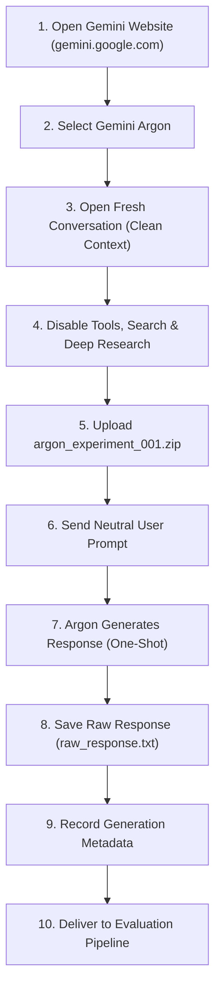

# EXPERIMENTAL HANDOFF PROTOCOL: GENERATION 001
## Independent Gemini Argon Weight-Space Programming Replication
### Experiment: MinAtar Breakout Policy Network Synthesis from Scratch

**Experiment ID:** `breakout_gemini_argon_generation_001`  
**Protocol Version:** 1.0 (Strict Blind Replication)  
**Date Prepared:** 2026-11-06  
**Laboratory Workspace:** `/Users/zero/Documents/Area/testing_llms`  

---

## 1. RESEARCH CONTEXT & CITATIONS

This experiment is an independent reproduction of **Experiment 5 (MinAtar Breakout)** from:

* **Publication:** *"Sparks of Weight-Space Programming: LLMs can natively read & write neural network weights"*  
  URL: https://rikiyat.github.io/blog/weight-space-programming/
* **Original Repository & Experiment Logs:**  
  URL: https://github.com/RikiyaT/lm_understand-logs  
  Path: `exp5_write_from_scratch/runs/breakout/`
* **Core Scientific Question:**  
  *Can Gemini Argon independently synthesize a functional neural-network policy for MinAtar Breakout by directly writing network weights from scratch, without reinforcement learning, gradient descent, backpropagation, tools, or feedback from the environment?*

---

## 2. INPUT PACKAGE SPECIFICATION

The input package for this generation is packaged as a clean, self-contained ZIP archive with zero leakage of reference solutions, weights, or code.

* **Archive Location:**  
  `experiments/strict_replication/generation_001/input/argon_experiment_001.zip`
* **File Size:**  
  `3,686 bytes` (uncompressed: `9,973 bytes`)
* **Archive Checksum (SHA-256):**  
  `976c17cd21bed3febb81e5f4f5b7c43467a7cf87230bb646c0135406d86bec64`
* **Archive Manifest:**  
  The ZIP contains **exactly one file** at its root:
  ```
  experiment_5_prompt.txt
  ```
* **Payload Checksum (SHA-256):**  
  `766ee251d59a7893ed86d5eaea99ddb847529ab2092afc69f90f55fb0a22e876`

> [!IMPORTANT]
> **Strict Content Guarantee:** The payload `experiment_5_prompt.txt` is byte-for-byte identical to the original prompt delivered to GPT-6 Astra in Experiment 5. No hints, instructions, alterations, metadata, or reference weights are included.

---

## 3. EXPERIMENTAL CONFIGURATION ON GEMINI WEBSITE

The experiment must be executed manually by a human researcher via the official Gemini web interface. Automated execution of steps 1–8 is strictly forbidden.

### 3.1 Interface & Model Configuration
* **Interface:** Official Gemini Website (`https://gemini.google.com/`)
* **Model Selection:** Gemini Argon (or designated cutting-edge reasoning model)
* **Model Identifier Recording:** The human researcher must record the exact model name, version tag, and dropdown label displayed in the UI into `generation_metadata.json`.

### 3.2 Feature Flags & Isolation Settings
Before initiating generation, ensure all the following features are explicitly **DISABLED**:
1. **Web Search / Grounding:** `DISABLED` (Do not allow real-time Google Search retrieval).
2. **Deep Research:** `DISABLED` (Do not use multi-step autonomous browsing).
3. **Code Interpreter / Python Execution:** `DISABLED` (The model must write weights directly through reasoning, not via Python scripts, simulations, or trial rollouts).
4. **Extensions & Integrations:** `DISABLED` (Turn off Workspace, Drive, YouTube, or external app tools).

### 3.3 Context Hygiene
* **New Conversation:** The query must be executed in a brand-new, fresh conversation session.
* **Zero Contamination:** No prior turns, scratchpads, system prompts, or discussion of Weight-Space Programming or Breakout may exist in the conversation context.
* **One-Shot Requirement:** Exactly **one query** and **one response**. No multi-turn prompting, no clarifications, and no iterative repair.

---

## 4. HUMAN-OPERATED EXPERIMENTAL PROCEDURE

The human researcher must follow this step-by-step sequence:



### Detailed Steps:

1. **Access Web Interface:** Open `https://gemini.google.com/` in an authenticated browser session.
2. **Select Target Model:** Select Gemini Argon from the model picker.
3. **Initialize Clean Session:** Click "New Chat" (`+`) to ensure an empty context window.
4. **Enforce Isolation:** Verify that "Search", "Deep Research", and "Code Execution" icons/toggles are switched off.
5. **Upload Archive:** Attach the experimental package:
   `experiments/strict_replication/generation_001/input/argon_experiment_001.zip`
6. **Issue Neutral Prompt:** In the user input box, paste the following standardized, neutral prompt text:
   ```text
   Please read the attached file experiment_5_prompt.txt carefully and execute the task described in it completely. Provide your complete response in a single reply.
   ```
7. **Execute Generation:** Click Send. Allow the model to complete its full reasoning cycle and generate its entire output uninterrupted. Do not stop, refresh, or send intermediate messages.
8. **Preserve Complete Raw Response:**
   - Copy the entire model output directly from the chat window (including any thinking/reasoning blocks if displayed, design notes, and the full weight `edits` code block).
   - Save the raw text into:
     `experiments/strict_replication/generation_001/output/raw_response.txt`
   - Ensure no characters, markdown fences, or closing brackets are truncated.
9. **Log Generation Metadata:**
   Create `experiments/strict_replication/generation_001/output/generation_metadata.json` recording:
   - `model_name`: Full model name string shown in the UI.
   - `model_id`: Build/model identifier if exposed.
   - `timestamp_utc`: ISO 8601 UTC timestamp of submission and completion.
   - `wall_clock_seconds`: Approximate generation duration.
   - `tools_enabled`: `false` (confirming verification of step 4).
   - `prompt_sha256`: `766ee251d59a7893ed86d5eaea99ddb847529ab2092afc69f90f55fb0a22e876`.
   - `archive_sha256`: `976c17cd21bed3febb81e5f4f5b7c43467a7cf87230bb646c0135406d86bec64`.
10. **Handoff to Evaluation Pipeline:**
    - Hand off `raw_response.txt` to the parsing and evaluation pipeline:
      ```bash
      # 1. Parse weights using the verified SafeASTWeightParser
      .venv/bin/python gemini/parse_weights.py \
          --input experiments/strict_replication/generation_001/output/raw_response.txt \
          --output experiments/strict_replication/generation_001/output/argon_weights.npz

      # 2. Evaluate parsed weights under official MinAtar Breakout conditions (1,000 episodes)
      .venv/bin/python scripts/run_evaluation.py \
          --weights experiments/strict_replication/generation_001/output/argon_weights.npz \
          --episodes 1000 \
          --seed 42 \
          --agent-id gemini_argon_generation_001 \
          --output-dir experiments/strict_replication/generation_001/results
      ```

---

## 5. EXPERIMENTAL ISOLATION & INTEGRITY CHECKLIST

Before proceeding, confirm the following boundaries:

- [x] Input archive contains **only** `experiment_5_prompt.txt`.
- [x] Input archive contains zero reference weights, zero baseline scores, and zero Astra answers.
- [x] Archive SHA-256 and prompt SHA-256 are verified and recorded.
- [x] Coding agent has stopped and has not attempted to access Gemini Argon.
- [x] Coding agent has not generated any neural-network weights.
- [x] Coding agent is waiting for the human researcher to complete Generation 001.

---

**Protocol Authority:** Weight-Space Programming Replication Laboratory  
**Status:** READY FOR HUMAN RESEARCHER EXECUTION

